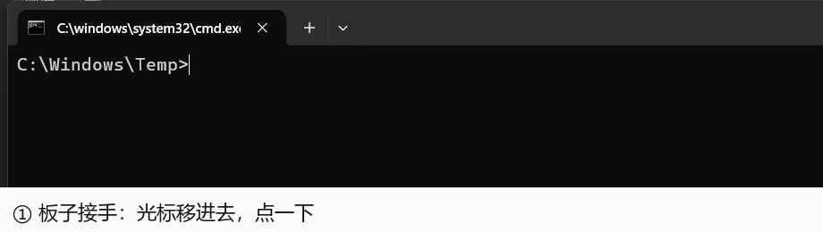

# esp32p4-hid-agent

**中文** | [English](README.en.md)

[](https://github.com/BSGGPRO/esp32p4-hid-agent/actions/workflows/ci.yml)

把一块 **ESP32-P4 开发板**变成这台 Windows 上的**标准 USB 键鼠**，再用一个 **JSON 连接器**把它用起来：
截屏 → 判断 → 动鼠标 / 敲键盘 → 再截屏核对。硬件输入、零驱动、不碰任何软件注入。

**为什么不用软件自动化？** 因为它对目标程序来说是一块真实的键盘鼠标：没有驱动、没有注入、
没有调试端口、不需要目标软件配合。Windows 认它就像认你桌上那副键鼠。



*真机录制，没剪辑：板子把光标移进控制台、一个键一个键敲下命令，再用 OCR 读回屏幕上的结果核对。
画面里只有一个为演示新开的空控制台（`C:\Windows\Temp`），光标是 Windows 自己画进画面的真实光标。*

```
   ┌──────────────┐  USB HID（键盘+鼠标）  ┌──────────────┐
   │ ESP32-P4 板子 │ ────────────────────▶ │  这台 Windows │
   └──────┬───────┘                       └──────▲───────┘
          │ UART 115200 / TCP 透传                 │ 截屏
   ┌──────▼───────────────────────────────────────┴───────┐
   │ tools/connector.py —— 读一份 JSON 作业，用板子执行     │
   └──────────────────────────────────────────────────────┘
```

## 30 秒看懂

| | |
|---|---|
| **要什么硬件** | 一块 ESP32-P4 开发板（带 USB HID 和 UART），一根 USB 线，一台 Windows |
| **要什么软件** | Python 3.12 + Pillow；OCR 可选（装了才能读屏幕上的字）；视觉模型可选（装了才能"看懂"界面） |
| **怎么用** | 往 `connector.py` 的 stdin 塞一段 JSON，它用板子执行，吐出 JSON 结果 |
| **出错怎么办** | 每一步都能核对；核对不上**整单失败并停手**，绝不带着错误继续按键 |

```bash
git clone https://github.com/BSGGPRO/esp32p4-hid-agent.git && cd esp32p4-hid-agent
python -m pip install -r pc/requirements.txt
python tools/connector.py --selfcheck          # 屏幕/OCR/板子/指针/视觉 五项状态

# 让板子把光标移到 (1200,600)，然后读屏幕左上角那行字
echo '{"steps":[{"op":"point","x":1200,"y":600},{"op":"ocr","rect":[0,0,600,140]}]}' \
  | python tools/connector.py
```

## 把控制器交给别的 AI

`esp32p4-agent.exe` 是这套东西的**单文件控制器**（约 29 MB，对方不用装 Python）：

```bash
esp32p4-agent.exe --manual      # 完整说明书（就是 docs/ai-controller.md，内嵌在里面）
esp32p4-agent.exe --caps        # 能力清单 JSON：26 个操作 + 铁律 + 服务状态
esp32p4-agent.exe --services    # hub / 视觉服务 / 板子 三处在不在
esp32p4-agent.exe --selfcheck   # 屏幕/OCR/板子/指针/视觉 五项
type job.json | esp32p4-agent.exe
```

把它丢给另一个能跑命令的 AI（Codex、Claude Code、任何 agent），它 `--manual` 一下就能上手；
只能读文字的聊天 AI 就读 [docs/ai-controller.md](docs/ai-controller.md)——同一份文件。

说明书第一页就是**铁律**，第一条是 **禁止改固件**：`firmware/` 只读，不许编译、烧录、
改任何固件源码或配置，要改先停下来问人。后面还有「不动用户窗口」「全屏不投键鼠」
「不可逆先问」「别猜坐标」——这几条是这套工具能安全交出去的前提。

EXE 不进版本库（是产物不是源码）：`tools\build-agent.cmd` 现打一个。要批量跑作业，
直接用 `python tools/connector.py` 更快——EXE 每次启动要自解压，多约 1 秒。

## 窗口版（给人用）

双击 `esp32p4-agent.exe` 会"闪退"，那不是崩：它是控制台程序，没带参数就打完一段用法、以退出码 2 退出，
窗口跟着关掉——它是给 AI 用的，不读 stdin 就没活干。

人要双击的是 `esp32p4-agent-ui.exe`（`tools\build-ui.cmd` 打出来的窗口版，没有控制台）：
一个窗口、一排按钮，其中**「保存 AI 说明书…（下载）」**把说明书存成 `.md`，直接拖给 Codex / 豆包 / Gemini。
按钮逐个说明、出错排查表、红线（**禁止改固件**）都在 [docs/agent-ui.md](docs/agent-ui.md)。

## 能拿来干什么

都是真跑过的，不是设想（实测耗时见[后面](#看和读有多快)）：

| 场景 | 一条作业 |
|---|---|
| **给微信某个人发一句话** | `{"op":"recipe","name":"wechat-send","to":"文件传输助手","pieces":["py:nihao"]}` —— 先核对聊天标题、清空输入框、拼音选字、发前核对、回车、发后核对气泡 |
| **打开一个网址** | `{"op":"recipe","name":"open-url","url":"https://github.com"}` —— 交给系统打开（Win+R，绕开地址栏自动补全），最后核对窗口标题 |
| **操作没见过的软件** | `{"op":"ui","exe":"cloudmusic"}` —— 把窗口读成「文字行 + 可疑按钮 + 屏幕坐标」，图标按钮没有文字也能定位 |
| **给播放器切歌** | `ui` 找到按钮 → `click` → 用窗口标题核对换歌成功 |

---

## 从零跑通（陌生机器）

两个前置，各做一次：

| 前置 | 怎么做 | 通过的标志 |
|---|---|---|
| Python 3.12 + Pillow | `python -m pip install -r pc/requirements.txt -i https://pypi.tuna.tsinghua.edu.cn/simple` | `python -c "import PIL; print(PIL.__version__)"` 有版本号 |
| CH340 串口驱动 | 管理员运行 `tools\install-ch340-admin.cmd`（或设备管理器里让 Windows 自动装） | 设备管理器「端口」下出现 `USB-SERIAL CH340 (COMx)` |

然后四条命令，每条都给了「该看到什么」：

```bash
git clone https://github.com/BSGGPRO/esp32p4-hid-agent.git && cd esp32p4-hid-agent

# 1) 编译 + 烧录（需要 ESP-IDF v5.5.6；COM7 换成你的口）
#    新克隆的仓库没有 build/，先 set-target 再 build；sdkconfig.defaults 和 partitions.csv 都在库里
tools\idf.cmd set-target esp32p4
tools\idf.cmd build
tools\idf.cmd -p COM7 flash
#  → 末行 "Hash of data verified."；高速口插到目标机后设备管理器出现 "P4 HID Bridge"

# 2) 自检：屏幕 / OCR / 板子 / 指针 / 视觉，五项一次看完
python tools/connector.py --selfcheck
#  → {"ok": true, ...}，退出码 0

# 3) 起服务（占串口，提供 TCP 透传 + 网页仪表盘）
python pc/hub.py
#  → http://127.0.0.1:8765 · TCP 127.0.0.1:8766

# 4) 让板子动一下：光标去 (1200,600)，再读屏幕左上角一小块的字
echo '{"steps":[{"op":"point","x":1200,"y":600},{"op":"ocr","rect":[0,0,600,140]}]}' | python tools/connector.py
```

第 1 步的细节（驱动来源、烧录参数、连不上怎么排）在
[docs/bringup-runbook.md](docs/bringup-runbook.md)；PC 侧接口在 [pc/README.md](pc/README.md)。

输出永远是 JSON：`{"ok": true, "steps": [...], "vars": {...}}`。
**任何一步核对不上就整单失败并停手**，不会带着错误继续动键鼠。

## 跑测试（不需要板子）

```bash
python tests/smoke.py          # 语法、纯逻辑、以及「README 写的操作数 = 代码里认的操作数」
python tests/web_selftest.py   # 仪表盘 70 项：静态页检查 + 离线拉起 hub 打接口，不碰板子
python tests/links.py          # 文档里的相对链接（只认 git 里真实存在的文件）
```

这三条都在 GitHub Actions 上每次推送自动跑（`windows-latest` + `ubuntu-latest`）。
要点鼠标、看屏幕、过串口的真机回归不在这里跑——那套只在真机上做。

---

## 连接器：一个文件，26 个操作

`tools/connector.py` 从 stdin 读作业、打印结果、**不落任何文件**。每个操作都能带 `require`，不满足就中止。

| 类别 | 操作 | 说明 |
|---|---|---|
| 窗口 | `restore` `focus` `title` `ui` | 还原 / 置前 / 读标题（以 Win32 为准）/ 把整个窗口读成结构 |
| 键鼠 | `click` `move` `point` `drag` `drag_path` `hold` `scroll` `key` `type` | `point` 是闭环定位，自己纠偏到目标像素；`click`/`move`/`point` 都认 `on=<find 变量>` |
| 观察 | `look` `ocr` `find` `diff` `wait_change` `read_text` | `find` 在区域里找一段文字并返回中心点 |
| 视觉 | `see` `check` `vision` | `check` 是是非题（只答「是/否」）；`see` 默认只要一句话（20 字内）；`vision action=unload` 立刻还显存 |
| 系统 | `clip` `launch` `wait` | 剪贴板读写 / 启动程序 / 等待 |
| 组合 | `recipe` | `wechat-send`、`open-url` —— 带完整核对的成品动作 |

### 看不懂的界面：`ui` 一条命令读出来

陌生软件里「按钮在哪」是最费时间的事，图标没有文字，OCR 看不见。`ui` 把窗口渲染出来后
**文字行 + 可疑按钮**一起给出，全部带屏幕坐标：

```json
{"op": "ui", "exe": "cloudmusic"}
→ {"texts": [{"text": "落泪", "cx": 210, "cy": 1180}, ...],
   "buttons": [{"cx": 313, "cy": 1022, "w": 34, "h": 34}, {"cx": 408, ...}, ...]}
```

两个关键点：用 `PrintWindow` 渲染，**窗口被别的窗口挡住也能读**；按钮靠亮度块找（再排除文字区域），
所以没文字的图标也能定位。实测：热路径 0.13~0.7 s，冷启动（含 OCR 引擎初始化）6.6 s。

**窗口标题会骗人。** 播放器、编辑器的标题就是当前内容（网易云的标题是歌名 `Daylight - Seredris`），
按应用名永远找不到——所以所有窗口操作都支持按进程名找：`{"op": "focus", "exe": "cloudmusic"}`。


### 看和读有多快

**OCR 常驻**（纯 CPU，不吃显存）；视觉模型**按需加载**——不用就一直不占显存，真要问图才装。
冷启动只有 OCR 约 **5 秒**，首次 `see` 另加约 11 秒装模型。稳态实测（2026-10-18 本机，空载）：

| 动作 | 耗时 |
|---|---|
| `ocr` 小块（约 5 行） | **0.12 s**（服务内）/ 0.62 s（含新进程启动） |
| `ocr` 大块（约 34 行） | 1.4 s |
| 同一作业里连续两次 `ocr` | 第二次几乎不额外花截图钱 |
| `ui` 读一个窗口（文字+按钮） | **0.13~0.7 s**（看窗口多大） |
| `see` `speed=fast`（长边 480） | 1.2 s |
| `see` 默认（长边 640） | 1.7 s |
| `see` `speed=fine`（长边 1280） | 3~4 s |
| `--selfcheck` 五项 | **1.1 s** |

> 机器忙（开着一堆程序、模型也在用显卡）时，上面这些数字会翻倍。相对比较仍然成立。

```bash
python tools/visiond.py --start     # 也可以不管：第一次 see/ocr 会自动拉起
python tools/visiond.py --status    # 在不在、OCR 和视觉各自就绪没、占多少显存
```

两个坑是实测踩出来的，也记在代码注释里：

- **OCR 默认按"短边缩到 736"**：一块 208×50 的小图会被放大 15 倍再检测（实测 625 ms）。
  改成"长边压到 1280"（`det_limit_type=max`）后同一张图 **64 ms**，文字一个字没变。
- **onnxruntime 默认吃满所有核**：本机 16 核反而比 8 核慢 30%，所以按核数一半传线程数。

**用 OCR 能回答的问题别问模型。** 文字、按钮名、坐标用 `ocr` / `find`，百毫秒级且不会瞎猜；
`see` 只用来回答「这是什么界面」「现在卡在哪个状态」这类模糊问题，而且是裁小图问。

### 显存会还给你（打游戏不卡）

视觉模型要占 2.5 GB 显存，本机是 8 GB 的笔记本卡，打游戏时这是实打实的一截。所以它**默认不占**：

- **开机不加载**：服务只预载 OCR（走 CPU），那 2.5 GB 等你第一次真的要问图才装；
- **空转 3 分钟自动卸载**（进程和 OCR 还留着），下次 `see` / `check` 自动装回来（约 11 秒）；
- **全屏自动卸载**（见下一节）。

```bash
python tools/visiond.py --unload     # 立刻还显存（开游戏前跑一下）
python tools/visiond.py --stop       # 连进程一起关（OCR 也停）
python tools/visiond.py --status     # 看模型现在在不在显存里
```

实测（同一时刻前后）：`nvidia-smi` 全卡占用 **3780 MiB → 1171 MiB**，卸掉 2609 MB。
只做 OCR 的一组作业全程 **1157 MiB** 没动过——模型一次都没装。
算力上：闲置时它就躺在那不跑推理，不掉帧；真正会掉帧的是你正玩着的时候恰好有个作业
在问模型——那种情况现在只会发生在你明确让它看东西的时候。

### 全屏 = 游戏模式（自动）

它看得懂你在干正事：**前台一进全屏，模型 5 秒内自动卸载，而且不再往里发键鼠。**

| 你在做什么 | 它怎么反应 |
|---|---|
| 全屏游戏 / 全屏视频 | 自动卸模型（显存还给游戏）；`key` `type` `click` `move` `point` `drag` `hold` `scroll` `recipe` 一律拒绝 |
| 确实要操作 | 那一条加上 `"force": true` 才放行 |
| 退出全屏 | `fullscreen` 变回 false，下次要用视觉自动装回（约 11 秒） |
| 不想让它自动管 | 环境变量 `DSV_GAME_MODE=0` 关掉这套 |

判据是「前台窗口盖住了整块屏幕（含任务栏）」，不是「窗口多大」：**最大化窗口盖不住任务栏**，
所以窗口化的游戏、最大化的浏览器都不会被误判。`python tools/visiond.py --status` 里能直接看到
`"fullscreen"` 和 `"game_mode"` 两个字段。

实测一轮（开一个真全屏窗口当游戏）：进全屏 3 秒内 `fullscreen: true`、模型从 2470 MB 卸到 0、
全卡 3560 → 956 MiB、按键被拒并给出明确理由；关掉窗口后 `fullscreen: false`。


成品动作示例（微信发一条中英混排消息，含标题核对与发后核对）：

```json
{"steps": [
  {"op": "recipe", "name": "wechat-send", "to": "文件传输助手", "pieces": ["py:nihao"]}
]}
```

`py:<拼音>` 走输入法出候选再选字，`raw:<ascii>` 直接敲字母。发前核对输入框内容，发后核对输入框已清空
且出现新气泡；对不上就报错，不算成功。

---

## 图片 → 画出来

把任意图片转成笔画，用板子在画图里一笔笔画出来（图片转笔画是确定性算法，不依赖模型视觉）：

```powershell
python tools\photo-to-draw.py 照片.jpg --quality good --draw   # 或双击 photo-draw.bat
python tools\draw-image.py "inbox\cat.png" --mode line --preview-width 4 --draw
```

实测：猫线稿 26 笔 / 193 顶点 / 约 4 秒，`pearson 0.92`；照片速写 42 笔 / 492 顶点。
细节见 [docs/image-to-draw.md](docs/image-to-draw.md)。1 px 铅笔做不到无损还原，能给钢笔/版画级可辨认画。

---

## 网页仪表盘（中英双语）

`python pc/hub.py` 起在 <http://127.0.0.1:8765>，每秒钟读一次板子统计（运行时长、双核占用、
内存、TF 卡、调频、网络、任务栈）。

右上角语言下拉可切 **中文 / English**，选择记在浏览器里；也可以直接用链接指定：

```
http://127.0.0.1:8765/?lang=en        # 英文
http://127.0.0.1:8765/?lang=zh        # 中文
```

翻译是渲染后的词表替换（`web/i18n.js`），不改面板逻辑；没收录的句子原样显示，不会把界面搞坏。

---

## 已验证状态（真机）

| 部分 | 状态 | 证据 |
|---|---|---|
| 固件 | ✅ 编译 + 烧录 + 真机运行 | `esp32p4_hid_agent.bin` 453,056 B |
| 可复现构建 | ✅ 从零克隆能编译 | `git clone` 到空目录 → `tools\idf.cmd build` 退出码 0，产物同为 453,056 B；生成的 `sdkconfig` 与本地 2749 行逐行一致 |
| USB 枚举 | ✅ 系统认成标准键鼠 | `HID Keyboard Device` + `HID-compliant mouse`，序列号 = 芯片 MAC |
| PC 桥 | ✅ 自检 39/39 | 截屏 2560×1440，仅依赖 Pillow |
| 协议 | ✅ v1.2 | 15 命令 / 7 错误码 / 4 事件 |
| 端到端 | ✅ 通过 | 截屏 → 移鼠标 → 再截屏差分，`E2E OK` |
| 性能 | ✅ 达标 | ping 18.4 ms、mouse_move 12.5 ms、连发 332 条/秒 |
| 指针精度 | ✅ 1 px | 四角标定，最差角误差 1 px |
| 自检 | ✅ 5/5 | `--selfcheck`：屏幕 2560×1440 / OCR / 板子 / 指针 / 视觉 |
| 视觉延迟 | ✅ 静态 1.2 s / 1.7 s | `speed=fast` / 默认；首次看图装模型 11 s 只付一次 |
| 读字延迟 | ✅ 0.12 s | `ocr` 小块，OCR 引擎常驻（改前每作业 2.7 s 重载） |
| 界面阅读 | ✅ 0.13~0.7 s | `ui` 一次给出窗口里的文字 + 可疑按钮 |
| 空转显存 | ✅ 1157 MiB | 只做 OCR 的整轮作业，模型一次都没装 |
| 自检 | ✅ 1.1 s，5/5 | `--selfcheck`，退出码 0 |
| 仪表盘双语 | ✅ 实测 | ⌄ 切 English 后刷新仍英文，`?lang=zh` 切回 |

---

## 接线：两个口都要插

| 口 | 接到 | 作用 |
|---|---|---|
| UART（CH340） | 本机 | 烧录 + 指令通道；换 USB 口会改 COM 号 |
| 高速 Type-C | 目标机 | USB HID 键鼠输出，`VID_303A&PID_4004` |

只插 UART：能收发协议但没有手。只插高速口：是键鼠但没有指令通道。**两个都要。**

---

## 限制与红线

- 一次只能一个透传客户端；独占失败报 `board_busy`。
- 板子是硬件键鼠，**会真的操作这台电脑**：不对着真人或不可逆动作盲点。
- 不移动、不缩放、不最大化用户窗口；只为目标窗口做「还原 + 置前」。
- 独占全屏程序（游戏等）会吞掉按键，此时不投键鼠。
- 中文输入依赖系统输入法；`raw:` 只在输入法组字时按回车提交。

---

## 目录

| 路径 | 内容 |
|---|---|
| `firmware/` | ESP-IDF 固件（纯 ESP-IDF，不用 Arduino） |
| `pc/` | PC 侧桥：`hub.py` 服务、`brain.py` 动作接口、协议实现 |
| `tools/` | `connector.py` 连接器 + 指针标定 + 图片转笔画 |
| `web/` | 板子状态网页仪表盘 |
| `docs/` | 硬件事实、协议、标定、排障、操作手册 |
| `inbox/` | 本地素材与产物（不参与版本库） |

---

## 文档

| 文档 | 讲什么 |
|---|---|
| [docs/ai-controller.md](docs/ai-controller.md) | **交给 AI 的说明书**：铁律、26 个操作、能直接抄的作业（`esp32p4-agent.exe --manual` 打印的就是它） |
| [docs/field-guide.md](docs/field-guide.md) | 单文件全量手册：架构 / 自检 / 接口 / 排障 |
| [docs/operations.md](docs/operations.md) | 日常操作约定与安全红线 |
| [docs/protocol.md](docs/protocol.md) | 串口/TCP 协议（v1.2，冻结） |
| [docs/hardware-facts.md](docs/hardware-facts.md) | 板子实测：芯片、时序、供电、TF 卡 |
| [docs/pointer-calibration.md](docs/pointer-calibration.md) | 指针标定：1 px 精度的来由 |
| [docs/bringup-runbook.md](docs/bringup-runbook.md) | 从零到跑通的步骤 |
| [docs/brain-usage.md](docs/brain-usage.md) | `brain.py` 接口用法 |
| [docs/image-to-draw.md](docs/image-to-draw.md) | 图片转笔画与绘制 |

---

## License

MIT，见 [LICENSE](LICENSE)。
